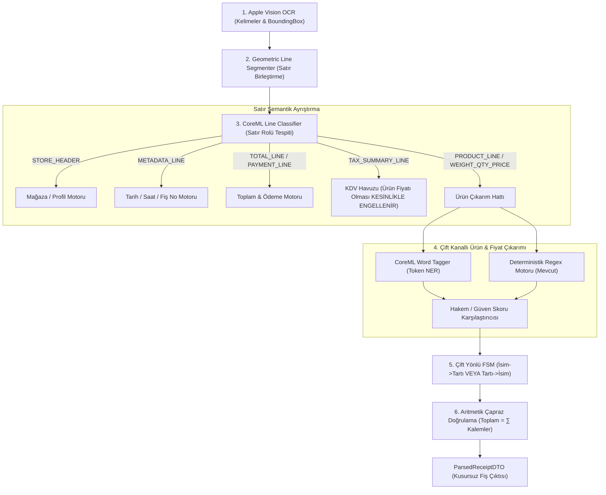

# CoreML Hibrit Entegrasyon ve Uygulama Planı
**Doküman Kodu:** `DOC-PLAN-COREML-001`  
**Tarih:** 24 Eylül 2026  
**Hedef Platform:** iOS 17.0+ | Swift 6 (Strict Concurrency) | Xcode 16/27  
**Konum:** `/Users/korkuteryigit/Xcode/Alisveris-fisTarama/Alisveris-fisTarama/Belgeler/coreml_hibrit_entegrasyon_plani.md`

---

## 1. Yönetici Özeti ve Problem Tanımı

### 1.1 Yaşanan Kritik Hata (FİLE Market Vakası)
Uygulamanın erken prototipinde gerçek bir FİLE market fişi test edildiğinde kritik bir ayrıştırma (parsing) hatası tespit edilmiştir:
1. **Ters Dizilim:** FİLE fişinde tartılı/miktarlı ürünlerde önce miktar satırı (`0.462 kg X 1,390.00 ·1 - *642.18`), hemen altındaki satırda ise ürün adı (`HARRAS ACILI SUCUK`) basılmaktadır. Mevcut deterministik motor sadece `İsim -> Miktar` (Forward) sırasını beklemektedir.
2. **Y-Ekseni Kırılması (OCR Glitch):** Geometrik satır segmentasyonu `TOPLAM KDV` ibaresi ile sağındaki `*6.36` tutarını farklı Y koordinatlarında algılayıp iki ayrı satıra bölmüştür.
3. **Fiyat Zehirlenmesi (Price Poisoning):** Regex motoru, bekleyen ürün adına (`pendingItemName = "HARRAS ACILI SUCUK"`) denk gelen ilk boş fiyat satırını kapmış ve **642.18 TL'lik sucuk, fişe 6.36 TL (KDV tutarı) olarak kaydedilmiştir.**

### 1.2 Çözüm Yaklaşımı: Hibrit AI + Deterministik Güvenlik Ağı
Mevcut çalışan deterministik mimari (Regex kütüphanesi, Tarih/Saat çıkarımı, VKN tespiti, Para birimi normalizasyonu ve Aritmetik dengeleyici) **kesinlikle çöpe atılmayacaktır.** 
Bunun yerine eğitilen iki adet Apple CreateML modeli sisteme **akıllı bir ön filtre ve güvenlik ağı** olarak eklenecektir:
* **`Alisveris_Fis_Takip_Classifier1.mlmodel` (Line Classifier):** Her satırın semantik rolünü belirler. `*6.36` satırının bir `TAX_SUMMARY_LINE` olduğunu bildirerek bu tutarın ürün fiyatı olarak kapılmasını kesin olarak engeller.
* **`Alisveris_Fis_Takip_tagger1.mlmodel` (Word Tagger / NER):** Satır içindeki kelimeleri (`PROD_NAME`, `QTY`, `UNIT`, `UNIT_PRICE`, `LINE_TOTAL`) etiketler. Ters sıralı satırları (`0.462 kg X 1,390.00`) ve ürün adlarını kusursuz ayrıştırır.

---

## 2. Hazır Olan Model Varlıkları ve Durum

Modeller Create ML ile başarıyla eğitilmiş ve projeye dahil edilmiştir:
* **Klasör:** `Alisveris-fisTarama/CreateML models/`
* **Line Classifier:** `Alisveris_Fis_Takip_Classifier1.mlmodel` (Maximum Entropy, 10 Sınıf: `PRODUCT_LINE`, `WEIGHT_QTY_PRICE`, `TOTAL_LINE`, `TAX_SUMMARY_LINE`, `STORE_HEADER`, `PAYMENT_LINE`, `METADATA_LINE`, `DISCOUNT_LINE`, `CAMPAIGN_INFO`, `NOISE`).
* **Word Tagger:** `Alisveris_Fis_Takip_tagger1.mlmodel` (CRF, 11 Sınıf: `PROD_NAME`, `QTY`, `UNIT`, `UNIT_PRICE`, `LINE_TOTAL`, `VAT_RATE`, `TOTAL_AMOUNT`, `TAX_AMOUNT`, `STORE_NAME`, `DATE`, `O`).
* **Derleme Durumu:** Xcode build sistemi modelleri algılamış ve otomatik Swift arabirimlerini üretmiştir (`** BUILD SUCCEEDED **`).

---

## 3. Katmanlı Hibrit Mimari Akış Şeması



---

## 4. Geliştirici Ajan İçin Adım Adım Görev Listesi (Micro-Steps)

Geliştirmeyi devralacak ajan aşağıdaki adımları sırasıyla, Swift 6 katı eşzamanlılık (`Sendable`, `actor`) kurallarına uyarak ve hiçbir mevcut testi kırmadan uygulamalıdır.

### Adım 1: DTO ve Enum Tanımları
* **Oluşturulacak Dosya:** `Alisveris-fisTarama/Services/Parser/ML/ReceiptMLModels.swift`
* **Gereksinimler:**
  ```swift
  public enum ReceiptLineRole: String, Sendable, CaseIterable {
      case productLine = "PRODUCT_LINE"
      case weightQtyPrice = "WEIGHT_QTY_PRICE"
      case totalLine = "TOTAL_LINE"
      case taxSummaryLine = "TAX_SUMMARY_LINE"
      case storeHeader = "STORE_HEADER"
      case paymentLine = "PAYMENT_LINE"
      case metadataLine = "METADATA_LINE"
      case discountLine = "DISCOUNT_LINE"
      case campaignInfo = "CAMPAIGN_INFO"
      case noise = "NOISE"
      case unknown
  }

  public struct TaggedTokenResult: Sendable, Equatable {
      public let token: String
      public let label: String
      public let location: Int
      public let length: Int
  }

  public struct ClassifiedReceiptLine: Sendable {
      public let line: SegmentedReceiptLine
      public let role: ReceiptLineRole
      public let confidence: Double
  }
  ```

---

### Adım 2: CoreML Çıkarım Servisi (ML Inference Actor)
* **Oluşturulacak Dosya:** `Alisveris-fisTarama/Services/Parser/ML/ReceiptMLInferenceService.swift`
* **Gereksinimler:**
  1. `actor ReceiptMLInferenceService: Sendable` olarak tanımlanmalıdır.
  2. Modelleri (`Alisveris_Fis_Takip_Classifier1` ve `Alisveris_Fis_Takip_tagger1`) thread-safe şekilde initialize etmelidir.
  3. `func classify(text: String) -> (role: ReceiptLineRole, confidence: Double)` metodunu sunmalıdır. Model hata verirse `.unknown` dönmeli, asla crash etmemelidir.
  4. `func tagTokens(in text: String) -> [TaggedTokenResult]` metodunu sunmalıdır.
  5. Toplu analiz için `func classifyLines(_ lines: [SegmentedReceiptLine]) async -> [ClassifiedReceiptLine]` metodunu sağlamalıdır.

---

### Adım 3: Çift Yönlü FSM ve Hibrit Ayrıştırma Motoru
* **Değiştirilecek Dosya:** `Alisveris-fisTarama/Services/Parser/TurkishReceiptParserEngine.swift`
* **Gereksinimler:**
  1. `TurkishReceiptParserEngine` sınıfına opsiyonel bir `mlService: ReceiptMLInferenceService?` enjekte edilebilir olmalıdır (`init(mlService: ... = nil)`). Eğer ML servisi yoksa mevcut saf regex motoru çalışmaya devam etmelidir (tam geriye dönük uyumluluk).
  2. **KDV Koruması:** `role == .taxSummaryLine` olan satırlar tespit edildiğinde:
     * Satırdaki sayı KDV havuzuna eklenir.
     * `pendingItemName` kesinlikle sıfırlanır (`nil`), böylece ürün fiyatı sanılması imkansız hale getirilir.
  3. **Çift Yönlü FSM (Bidirectional FSM):**
     * **Akış A (Standart):** `PRODUCT_LINE` -> ardından `WEIGHT_QTY_PRICE` gelirse birleştir.
     * **Akış B (FİLE Market):** Önce `WEIGHT_QTY_PRICE` gelirse miktar/tartı bilgisi saklanır (`pendingSubline = subline`). Bir sonraki satır `PRODUCT_LINE` (`HARRAS ACILI SUCUK`) geldiğinde önceki miktar bilgisi ile anında birleştirilerek eksiksiz `ParsedItemDTO` üretilir.
  4. **Hakem Mekanizması:** Token ayrıştırmada Word Tagger `PROD_NAME` ve `LINE_TOTAL` yakalarsa öncelikli kullanılır. Sayısal dönüşüm daima `CurrencyNormalizer` üzerinden Decimal olarak yapılır.

---

### Adım 4: AppContainer ve Bağımlılık Yönetimi
* **Değiştirilecek Dosya:** `Alisveris-fisTarama/App/AppContainer.swift`
* **Gereksinimler:**
  1. `AppContainer` içinde `receiptMLService` singleton actor örneği oluşturulmalıdır.
  2. `TurkishReceiptParserEngine` oluşturulurken `mlService` enjekte edilmelidir.

---

### Adım 5: Birim ve Karşılaştırma Testleri (Benchmark Tests)
* **Değiştirilecek Dosya:** `Alisveris-fisTaramaTests/ReceiptParserEngineBenchmarkTests.swift`
* **Gereksinimler:**
  1. **FİLE Sucuk Regresyon Testi:** 
     Gerçek FİLE fişinin OCR çıktısı test senaryosu olarak eklenmeli:
     ```swift
     "0.462 kg X 1,390.00 ·1 - *642.18\nHARRAS ACILI SUCUK\n*6.36\nTOPLAM KDV\n*357.00\nOdenecek KDV Dahil Tutar"
     ```
     * Doğrulama 1: Çıkarılan ürün sayısı 1 olmalı.
     * Doğrulama 2: Ürün adı `"HARRAS ACILI SUCUK"` olmalı.
     * Doğrulama 3: Ürün toplam fiyatı `642.18` olmalı (kesinlikle `6.36` OLMAMALI).
     * Doğrulama 4: Toplam KDV `6.36` olmalı.
  2. **Mevcut 14 Test:** Önceden yazılmış tüm testler çalıştırılmalı ve 0 hata ile geçmelidir.

---

## 5. Kabul Kriterleri (Acceptance Criteria)

- [ ] Hiçbir harici cloud / backend bağımlılığı eklenmemelidir (Tüm çıkarım CoreML on-device Neural Engine üzerinde < 5ms sürmelidir).
- [ ] Swift 6 katı eşzamanlılık uyarısı (warning) veya veri yarışı (data race) olmamalıdır.
- [ ] FİLE market fişi testinde sucuk fiyatı 6.36 TL yerine 642.18 TL olarak hatasız çıkmalıdır.
- [ ] `xcodebuild test` komutu tüm test suitinde yeşil (`** TEST SUCCEEDED **`) vermelidir.
